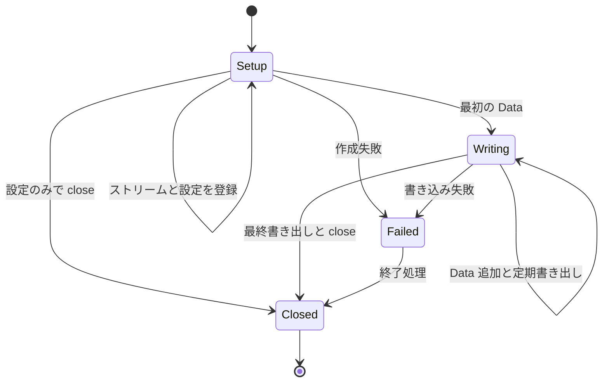

# 実装詳細: RealSense ROSbag → VRS

**更新日: 2026-10-30 / パッケージ版: 0.1.0 / 保存形式版: 2**

この文書は現行の実装を説明します。2025年の設計書・作業記録は履歴資料として残しています。使用例は [VRS_API_CHEATSHEET.md](VRS_API_CHEATSHEET.md)、人工データの仕様と合格条件は [SYNTHETIC_E2E.md](SYNTHETIC_E2E.md) を参照してください。

## 1. 公式実装とプロジェクト側の責務

| 層 | 実装 | 責務 |
|---|---|---|
| ROSbag 読み出し | `rosbags.highlevel.AnyReader` | 接続情報、メッセージ、時刻、型定義の読み出し |
| 変換 | [rosbag_to_vrs_converter.py](../scripts/rosbag_to_vrs_converter.py) | トピック対応、設定取得、画像・IMU 変換、件数・時間の集計 |
| 画像の解釈 | [image_payload.py](../scripts/image_payload.py) | 画素型、行余白、バイト順、寸法の検証 |
| 書き込み API | [vrs_writer.py](../scripts/vrs_writer.py) | 保存規約、入力検証、書き出し時機、終了処理 |
| VRS 書き込み本体 | 公式 `vrsbindings.Writer`／`Stream` | レコード生成、圧縮、非同期ファイル書き込み |
| VRS 読み出し本体 | 公式 `pyvrs.SyncVRSReader` | VRS の解析、画像・数値メタデータの取得 |
| 互換読み出し API | [vrs_reader.py](../scripts/vrs_reader.py) | 論理 ID、設定辞書、画像・IMU・旧形式のバイト列復元 |

依存の固定版は [uv.lock](../uv.lock) の **vrs 1.2.2** です。2026年10月30日確認時点の [公式最新公開版](https://github.com/facebookresearch/pyvrs/releases/tag/v1.2.2)を使用し、未公開の `main` や未統合の変更には依存しません。

2026年7月の移行で自作 C++ ライターは削除されています。現行コードは公式パッケージのネイティブ API を直接使うため、高水準の `pyvrs.writer` の公開名不足を補うモジュール書き換えも不要です。[公式ネイティブライターの実装](https://github.com/facebookresearch/pyvrs/tree/v1.2.2/csrc/writer)に対応する呼び出しだけを行います。

## 2. 変換の順序

`convert()` は1回のコンテキスト内で bag を開き、次の順序で処理します。設定探索とデータ変換で複数回走査しますが、bag を何度も開き直す構成にはしていません。

1. CameraInfo、最初の画像・IMU のヘッダー、Transform、StreamInfo、Device／Sensor 情報、Options を取得します。
2. 画像寸法・符号化、校正、IMU の情報、深度倍率を確定します。
3. ライターへ全ストリームと設定を登録します。
4. bag の時刻順に画像・IMU を変換し、Data レコードを作成します。
5. 待機中のデータを定期的に書き出します。
6. 最終レコードまで書き出してファイルを閉じ、統計を返します。

画像のバイト列を設定情報として保持し続ける必要はありません。変換を再実行すると、前回の件数と設定のキャッシュをリセットします。

`total_messages`／`messages_per_stream` は **出力した Data レコードの件数**です。Transform やデバイス情報など、設定取得だけに使用した入力メッセージは数えません。記録時間は bag の最初から最後までの時刻差を求め、最初の約1秒で走査を打ち切る旧方式は使いません。

## 3. ライターの状態と時刻

最初の Data 作成時に、公式ストリーム、タグ、Configuration レコードをすべて構築してからファイルを開始します。開始後の `add_stream()` と `write_configuration()` は拒否します。呼び出し側が元の設定辞書を後から変更しても記録内容が変わらないよう、設定登録時に JSON として複製します。

Data の時刻は、全ストリームを通じて非減少である必要があります。同じ時刻の RGB・深度・IMU や、書き出し境界をまたぐ同時刻レコードは許可します。負値・NaN・無限大・前の Data より古い時刻は拒否します。

ROSbag のナノ秒時刻は `timestamp / 1e9` により秒へ変換します。相対時刻だけでなくエポック時刻も扱いますが、VRS に渡す時刻は浮動小数であるため、ナノ秒整数の完全一致を一般に保証するものではありません。最後のレコードと同じ時刻を取りこぼさないよう、公式書き出し処理へ渡す境界は次の表現可能な浮動小数値に進めます。

### 待機データの制御

| 制御対象 | 既定値・動作 |
|---|---|
| 待機中のペイロード | 16 MiB。次のレコードを加えると超える場合は先に書き出します |
| 待機中の Data レコード数 | 256件で書き出します |
| 公式ライターの背景キュー | 64 MiB 超過時は排出を待ちます |
| 背景キューの待機 | 30秒以内に閾値以下にならなければエラーにします |
| 単一の大きなレコード | 1件で閾値を超える場合があります。追加後に書き出します |
| 正常終了 | 最終レコードを書き出し、公式 `close()` の結果を確認します |
| 例外終了 | 元の例外を保持しながらネイティブライターを終了します |

これらは待機データの制御値です。配列、圧縮処理、ネイティブライブラリを含めたプロセス全体のメモリ使用量の厳密な上限ではありません。公式 API の非ゼロ終了コードは例外として通知します。`close()` は冪等です。

## 4. 保存形式バージョン 2

本節の版番号は、このリポジトリの保存規約の版です。VRS ファイル形式、PyVRS、C++ VRS のライブラリ版とは別に管理します。定義は [vrs_schema.py](../scripts/vrs_schema.py) にあります。

### タグ

ファイルと各ストリームに `vrs_sandbox_schema_version="2"` を記録します。各ストリームはさらに次を保持します。

| タグ | 内容 |
|---|---|
| `user_stream_id` | 利用者向けの論理 ID |
| `user_stream_name` | 論理ストリーム名 |
| `config_json` | 元のセンサー設定を含む JSON |
| `payload_encoding` | 画像、IMU、汎用バイト列の区別 |

VRS の実ストリーム ID は公式実装が採番します。`1001` などの論理番号と同じ値になることには依存しません。

### 画像

画像には公式 `sample_with_image` 作成処理を使用します。Configuration の `image_width`・`image_height`・`image_pixel_format` に実際の寸法と画素型を設定し、連続した NumPy 配列を画像ブロックとして渡します。`payload_encoding` は `native_image` です。

| ROS 符号化 | VRS 画素形式 | 配列 |
|---|---|---|
| `rgb8` | `RGB8` | 高さ×幅×3、uint8 |
| `bgr8` | `BGR8` | 高さ×幅×3、uint8 |
| `rgba8` | `RGBA8` | 高さ×幅×4、uint8 |
| `mono8`／`8UC1` | `GREY8` | 高さ×幅、uint8 |
| `mono16`／`16UC1` | `GREY16` | 高さ×幅、uint16 |
| `32FC1` | `DEPTH32F` | 高さ×幅、float32 |

変換時には ROS Image の `step` で各行を解釈し、余白を除きます。多バイト画素の `is_bigendian` を反映し、ライターに渡すバイト列をリトルエンディアンにそろえます。画像データ長・寸法・符号化と CameraInfo の整合性を検証します。

校正は `camera_k`・`camera_d`・`camera_r`・`camera_p`、歪みモデル、frame_id として `config_json` に保存します。ROS1 の大文字属性と ROS2 の小文字属性を読み取る補助処理があります。

深度倍率は対象センサーの Depth Units を使用します。設定名の空白とアンダースコアの差を吸収し、同じ設定名が別センサーにあっても混同しません。記録がなければ `0.001` を採用し、`depth_scale_source="default_millimeters"` と明示します。記録値を使用した場合は `recorded_depth_units` です。

### IMU

公式 `sample` 作成処理を使用し、`doubles` 数値メタデータに x・y・z を保存します。`payload_encoding` は `imu_xyz_f64le` です。IMU を画像ブロックに格納しません。

既存の変換器向け API は24バイトのリトルエンディアン double 3個を受け取り、公式 API に渡す前に数値へ展開します。リポジトリのリーダーは同じ24バイト形式に復元します。設定にはセンサー種別、単位、frame_id、記録された fps／sample_rate を保持します。取得頻度やノイズ校正が不明な場合は `null` とし、推測値を作りません。

### その他のバイト列と設定のみのストリーム

未定義のバイト列には公式 `sample` と `some_string` を使い、Base64 として格納します。`payload_encoding="opaque_base64"` により明示し、リーダーで検証付き復号を行います。

Transform・Device・Sensor・Options などは `config_json` と Configuration レコードだけで保存できます。空の画像や空の Data レコードを作る必要はありません。

## 5. 読み出しと過去形式への対応

`VRSReader` は公式 `SyncVRSReader` を使い、`ImageConversion.OFF` により表示向けの深度正規化を無効にします。現行形式はバージョンと `payload_encoding` で解釈します。未知の保存形式バージョンや符号化を黙って読み替えることはせず、エラーにします。

保存形式バージョンのない旧ファイルについては、次の読み出し経路を維持します。

- `user_stream_id` タグ、または旧 `flavor` 内の `|id:` からの論理 ID 復元
- タグ、または旧 Configuration のメタデータにある `config_json`
- 旧 C++ ライターの CUSTOM ブロック
- 旧 PyVRS アダプターの1行 GREY8 画像と `payload_len`

旧 GREY8 形式はテスト中に公式 API で再生成して読み戻します。CUSTOM の互換処理を維持していることは、任意の過去の収録ファイルを実測で検証したことを意味しません。

## 6. 検証範囲と残る制約

[tests/test_synthetic_e2e.py](../tests/test_synthetic_e2e.py) は、本物の ROS1 bag と VRS を使います。画像を含む入力 bag を独立に読み取り、出力は公式 PyVRS リーダーで直接検証します。詳細な比較項目と再現手順は [SYNTHETIC_E2E.md](SYNTHETIC_E2E.md) に記載しています。

[tests/test_converter_synthetic.py](../tests/test_converter_synthetic.py) の代替リーダー／ライターを使うテストは、変換の分岐を検証する別の層として残しています。これらだけをもって実 VRS 変換に成功したとは扱いません。

現在の制約は次のとおりです。

- 公式の公開サンプル作成処理は `UnitTest1` 記録型です。画像型や数値型が正しくても、Aria 固有の記録型への適合は保証しません。
- ROS1 の人工 RealSense 型 bag を検証しています。任意のトピック配置、全 ROS2 記録、実機の全収録条件は対象外です。
- 赤外線画像、フレームごとの追加メタデータ、IMU の姿勢・共分散などをすべて保存する実装ではありません。
- 校正や設定はストリームの固定情報として保持します。記録途中の校正・画像寸法・符号化変更への対応は保証しません。
- 実収録の bag は取得・アップロードしません。外部の bag を使う検証は、利用者が `REALSENSE_ROSBAG_PATH` で明示した場合に限ります。
